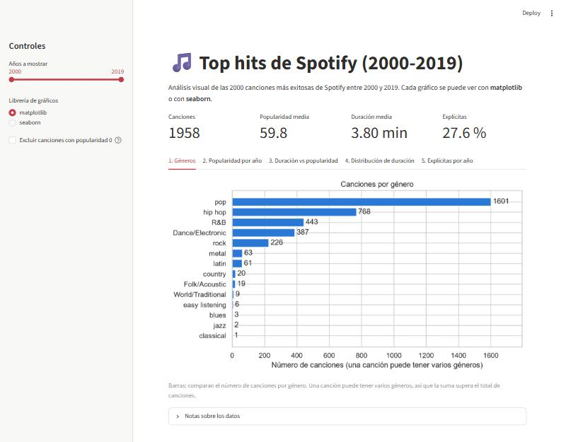
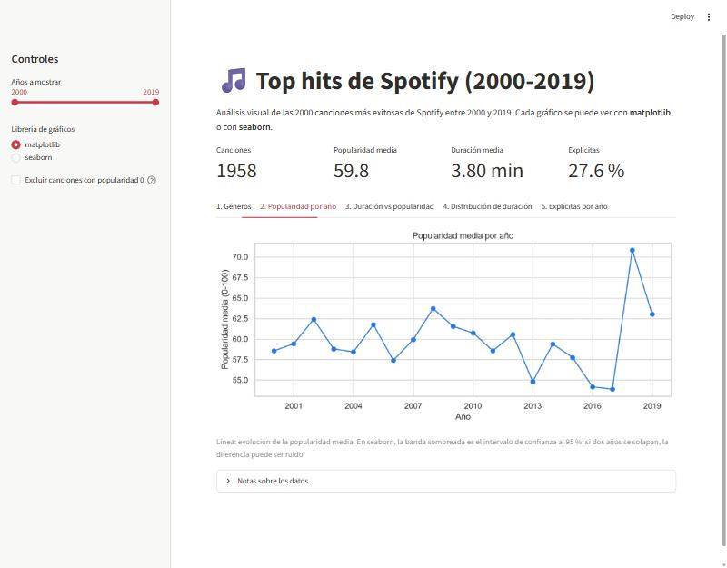
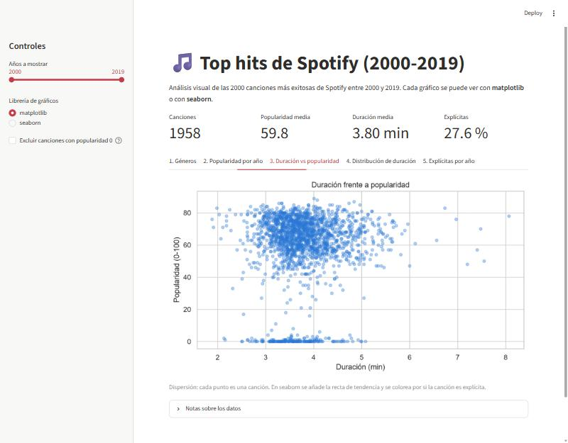
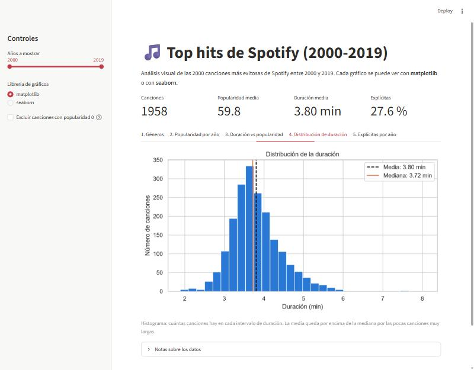
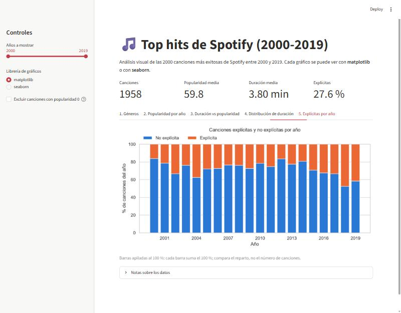

# Gráficos con Matplotlib, Seaborn y Streamlit

**Ejercicio:** elegir 5 gráficos e implementar un cuaderno que los muestre con **Matplotlib** y con **Seaborn**, y después una página de **Streamlit** que visualice esos mismos 5 gráficos.

**Autor:** Daniel Meléndez Loreto

## Qué se entrega y dónde está

| Lo que pide el ejercicio | Dónde está |
|---|---|
| Elegir 5 gráficos | [Los 5 gráficos elegidos](#los-5-gráficos-elegidos) |
| Un cuaderno con los 5 gráficos en Matplotlib y, en el mismo cuaderno, los mismos en Seaborn | [`graficos_musica.ipynb`](graficos_musica.ipynb) (los gráficos se ven al abrirlo en GitHub) |
| Una página de Streamlit que visualice esos 5 gráficos | [`app.py`](app.py) y las [capturas de más abajo](#página-de-streamlit) |

## Los 5 gráficos elegidos

Se usan datos reales de Kaggle (*Top Hits Spotify from 2000-2019*: 2000 canciones y 18 columnas). Los cinco tipos de gráfico son de los vistos en clase (Chart Chooser).

| # | Gráfico | Pregunta que responde | Columnas usadas |
|---|---|---|---|
| 1 | Barras | ¿Qué géneros hay más en los éxitos? | `genre` |
| 2 | Línea | ¿Cómo cambia la popularidad media por año? | `year`, `popularity` |
| 3 | Dispersión | ¿Las canciones más largas son más populares? | `duration_ms`, `popularity`, `explicit` |
| 4 | Histograma | ¿Cuánto duran normalmente las canciones? | `duration_ms` |
| 5 | Barras apiladas al 100 % | ¿Qué porcentaje de canciones explícitas hay cada año? | `year`, `explicit` |

## Cuaderno: Matplotlib y Seaborn

[`graficos_musica.ipynb`](graficos_musica.ipynb) contiene, para cada uno de los 5 gráficos:

1. La versión con **Matplotlib**.
2. La misma versión con **Seaborn**, justo debajo.
3. Un texto con qué muestra, cómo leerlo, el resultado y sus limitaciones.

Antes de los gráficos, el cuaderno explica la limpieza de los datos (solo años 2000-2019, canciones sin género y duración en minutos) y al final recoge las conclusiones.

## Página de Streamlit

[`app.py`](app.py) muestra los mismos 5 gráficos, uno por pestaña. En la barra lateral se puede elegir el rango de años, la librería con la que se dibujan (**matplotlib** o **seaborn**) y excluir las canciones con popularidad 0.

**1. Géneros (barras)**



**2. Popularidad media por año (línea)**



**3. Duración frente a popularidad (dispersión)**



**4. Distribución de la duración (histograma)**



**5. Canciones explícitas por año (barras apiladas al 100 %)**



### Cómo ejecutar la página (Windows)

1. Instala Python 3 y abre una terminal en la carpeta del proyecto.
2. Instala las librerías:

   ```
   py -m pip install -r requirements.txt
   ```

3. Arranca la página:

   ```
   py -m streamlit run app.py
   ```

   Se abre en el navegador (normalmente en http://localhost:8501). Para pararla, `Ctrl+C` en la terminal.

## Datos

Conjunto de datos *Top Hits Spotify from 2000-2019* (Kaggle), archivo `songs_normalize.csv`, incluido en la carpeta `data/`. Si no está, la página permite subirlo desde ella misma.

## Resultados principales

- El pop aparece en el 81,8 % de las canciones (1601 de 1958); le siguen hip hop, R&B, Dance/Electronic y rock.
- La popularidad media se mueve entre unos 54 y 64 puntos casi todos los años, con un pico en 2018 (70,9) que se explica en buena parte por las canciones con popularidad 0, concentradas en 2012-2017 (explicación razonable, no verificada).
- La duración casi no influye en la popularidad (correlación de 0,051, y de -0,003 sin las canciones con popularidad 0). La mayoría de canciones dura entre 3,4 y 4,1 minutos.
- Hay 126 canciones con popularidad 0, probablemente sin dato (hipótesis no verificada).
- El porcentaje de canciones explícitas sube del 16,2 % en 2000 al 47,7 % en 2018.

Las conclusiones completas y las limitaciones de cada gráfico están en el cuaderno.

## Estructura del repositorio

| Archivo | Para qué sirve |
|---|---|
| `graficos_musica.ipynb` | Cuaderno con los 5 gráficos en Matplotlib y Seaborn |
| `app.py` | Página de Streamlit |
| `requirements.txt` | Librerías necesarias |
| `data/songs_normalize.csv` | Datos |
| `docs/` | Capturas de la página de Streamlit |

## Tecnologías

Python, pandas, matplotlib, seaborn, Streamlit.
